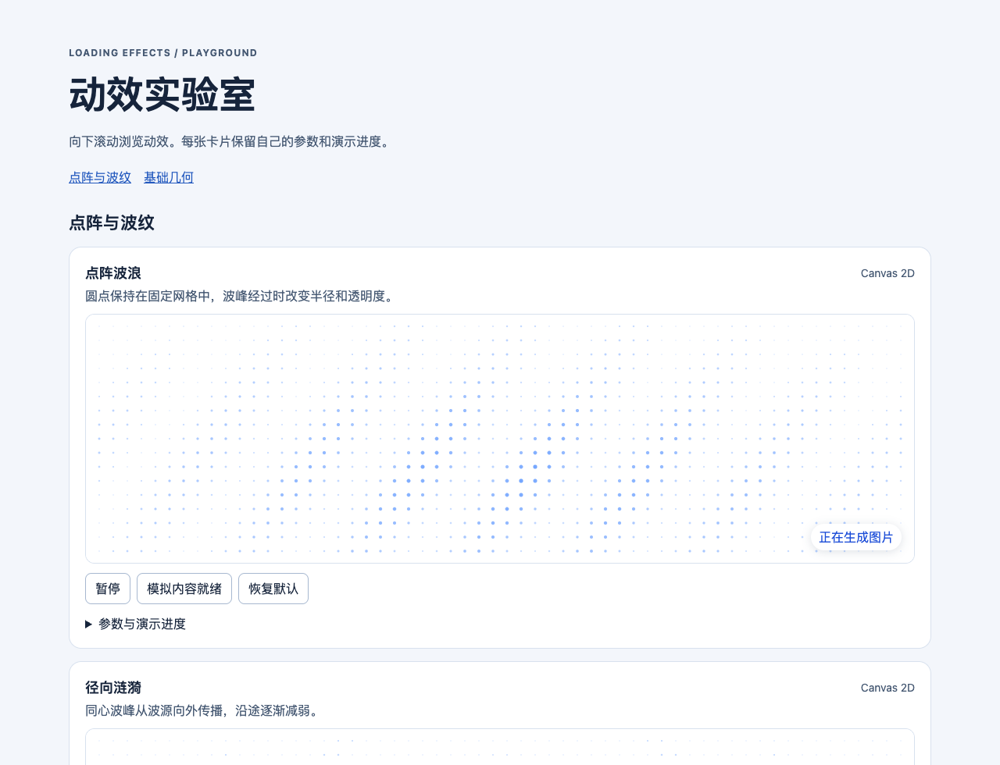

# Loading Effects

面向 Web 应用的可配置、跨框架 Loading 动效库。规划覆盖按钮和表单等待、全画布生成、真实任务进度与内容占位。

## 开始

需要 Node.js 22 或更新版本与 pnpm 10。根配置锁定本次初始化使用的 pnpm 10.34.9。

```sh
pnpm install --frozen-lockfile
```

Playground 已接入 33 种预设。`v1.0.0-alpha.1` 在 v0.2 的基础上增加输入省略号、字符波浪、文字流光和字符解码。

```sh
pnpm --filter @loading-effects/app-playground dev --port 4173
pnpm --filter @loading-effects/app-playground build
```

启动后打开 [本地 Playground](http://127.0.0.1:4173/)。动效按类别从上到下排列。展开卡片的「参数与演示进度」即可实时调参。画布滚出视口后停止绘制，滚回时从原相位继续，并保留该卡片的演示进度。交互涟漪可点击、轻触画布或通过按钮从中心触发。预览支持暂停、静态模式以及确定、估算和未知进度。



## 框架示例

Playground 每张动效卡片的「查看代码」默认折叠。展开后可切换 Vue、React、Web Components 和 JS、TS，复制带有当前动效参数的组件示例。

```sh
pnpm --filter @loading-effects/example-frameworks dev --port 4174
```

打开 [React、Vue 与 Web Components 示例](http://127.0.0.1:4174/)，可以切换动效、更新参数及反复挂载和卸载。包通过本地工作区引用。

- [Vanilla JS 用法](packages/core/README.md)
- [React 用法](packages/react/README.md)
- [Vue 用法](packages/vue/README.md)
- [Web Components 用法](packages/web-components/README.md)

## 文档

Docusaurus 直接使用根目录的文档与图片，支持本地预览和 GitHub Pages 发布。参见[文档站运行与部署说明](apps/docs/README.md)。

- [接入指南与生命周期](docs/integration.md)
- [产品需求与里程碑](docs/product-requirements.md)
- [回归与发布检查](docs/release-v01.md)
- [10 类 50 项动效目录](docs/effect-catalog.md)
- [8 种基础几何动效演示](docs/effect-catalog.md#基础几何演示)
- [6 种点阵动效演示](docs/dot-matrix-ripple.md#点阵与波纹演示)
- [点阵波纹产品需求与参考图](docs/dot-matrix-ripple-prd.md)
- [动效库构想与视觉参考](docs/loading-effects-concept.md)
- [点阵波纹详细规范](docs/dot-matrix-ripple.md)
- [架构与技术设计](docs/architecture.md)

`packages/` 包含引擎、动效、三个渲染器与三个框架适配工作区。仓库根目录的 `docs/` 存放规范，`apps/docs/` 是文档网站工作区，`apps/playground/` 是交互实验室工作区。
