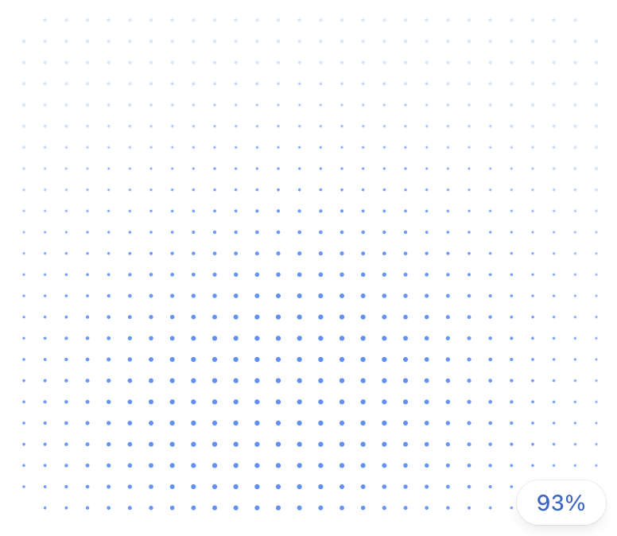
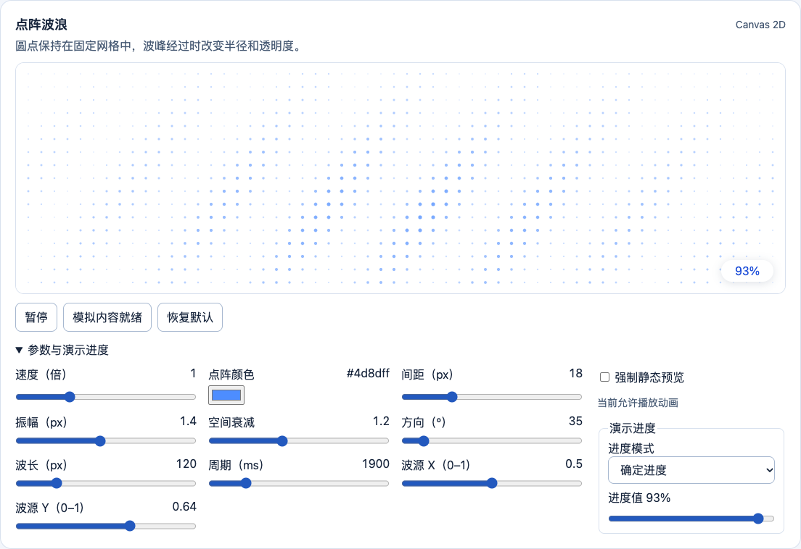
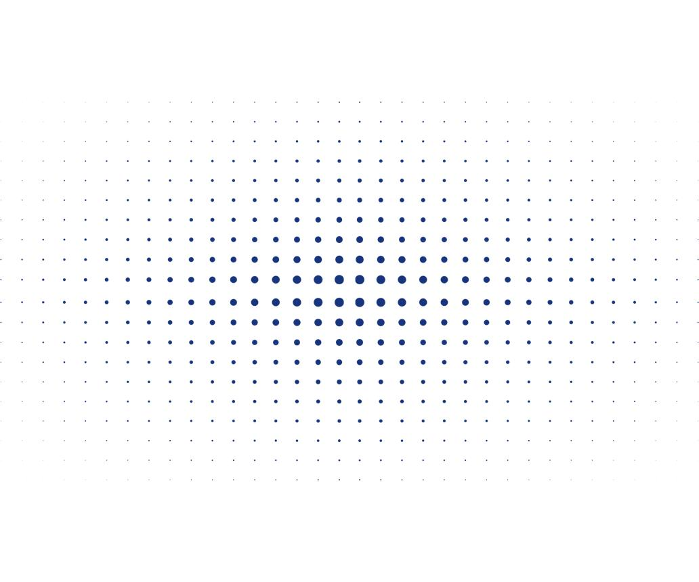
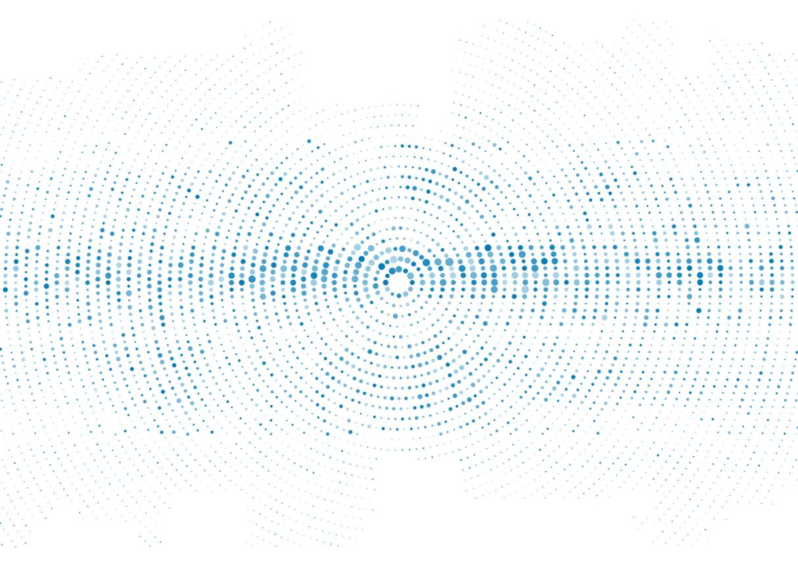

# 点阵波纹式画布加载动画 PRD

## 功能概述

点阵波纹式画布加载动画（Dot Matrix Ripple Loading）用于进入画布或执行图片生成任务时的等待状态。动效覆盖整个画布容器，以规则蓝色点阵、空间渐变和动态波纹表现持续生成感。有任务进度时，右下角的胶囊同步显示百分比。

## 原对话截图

原对话上传的 ChatGPT 图片生成等待画面。下文的参考图分别用于说明规则点阵、波纹和空间渐变。

## Playground 实现截图

展开点阵波浪卡片的「参数与演示进度」，选择「确定进度」并将演示进度设为 `93%` 后，画布右下角显示百分比胶囊。

点击「模拟内容就绪」后，点阵与进度胶囊淡出，画布在原位置显示「预览已就绪」。当前演示以这行文字模拟结果。

## 视觉设计

- 画布使用纯白背景 `#FFFFFF`，保持界面简洁。等待反馈由点阵承担。
- 实心圆点无描边，默认使用蓝色 `#4D8DFF`。圆点沿水平和垂直方向等距排列，均匀覆盖整个画布。容器尺寸变化时重新排布，保持网格规律。
- 中心和中下部的圆点更大、颜色更明显。向上方和边缘平滑过渡为更小、更浅的圆点。

## 动画与进度

- 圆点中心保持固定。相邻圆点在不同时间达到半径与透明度的峰值，形成连续传播的波纹。循环首尾平滑衔接，长时间播放保持稳定。
- 进度胶囊固定在画布右下角，采用白底、圆角、轻阴影和蓝色数字，例如 `93%`。数值变化时保持宽度稳定。
- 百分比取自真实任务进度或明确的估算策略。估算值标注“预计”，未知进度显示状态文字。Playground 的进度明确标为演示数据。
- 内容就绪后停止波纹，点阵与进度胶囊同步淡出，画布内容平滑呈现。减少动态时立即切换。

## 性能与无障碍

- 前台动画以 60 FPS 为目标。优先使用 Canvas 2D，需要时采用 GPU 加速。圆点批量绘制，避免为每个点创建 DOM 节点。
- 按容器尺寸及设备性能控制点阵密度。页面进入后台时暂停，恢复可见后继续当前相位。
- 跟随 `prefers-reduced-motion`。本项目使用静态点阵，保留可读状态与进度。

## 关键视觉特征

### 规则点阵（Dot Matrix）

圆点中心按二维网格排列。间距随容器布局计算，播放时圆点中心固定。

### 波纹传播（Ripple Propagation）

相邻点的缩放存在相位差，使波峰从一个点传播至下一个点。

### 空间渐变（Spatial Gradient）

半径与透明度带有空间权重，中下部和边缘形成平滑的视觉层次。

## 研发任务摘要

> 实现类似 ChatGPT 图片生成场景的全画布点阵 Loading。纯白画布中等距排列蓝色实心圆点，中心偏下的点较大、颜色更明显。以固定点位、变化的半径和透明度、相邻点的相位差形成平滑循环波纹。右下角以白色胶囊展示任务进度，内容就绪时与点阵同步淡出。画布随容器调整，优先采用 Canvas 2D，并提供减少动态时的静态预览。

静态截图提供点阵排列、颜色、空间渐变及进度组件的视觉参考。传播方向、周期和波函数由本库设计。具体参数和验收见[点阵波纹实现规范](dot-matrix-ripple.md)。
