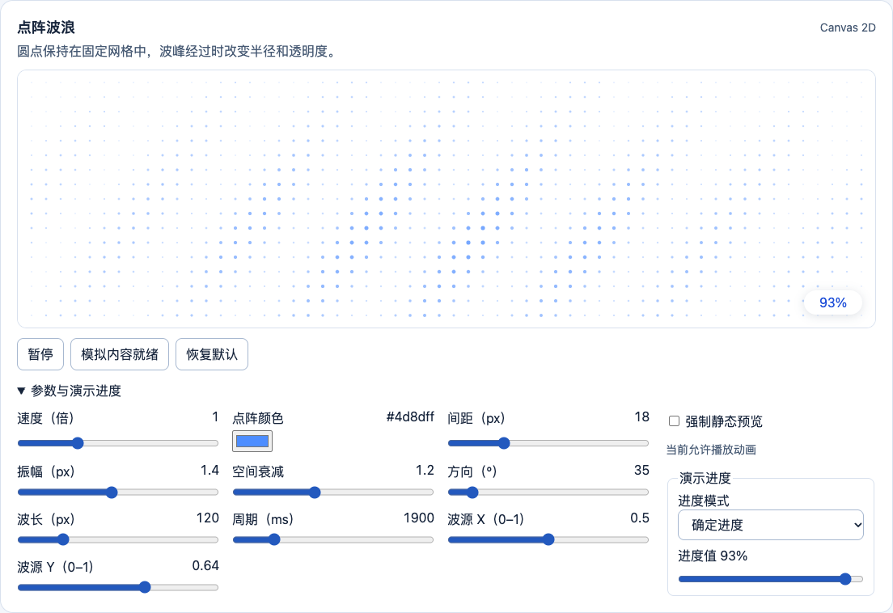
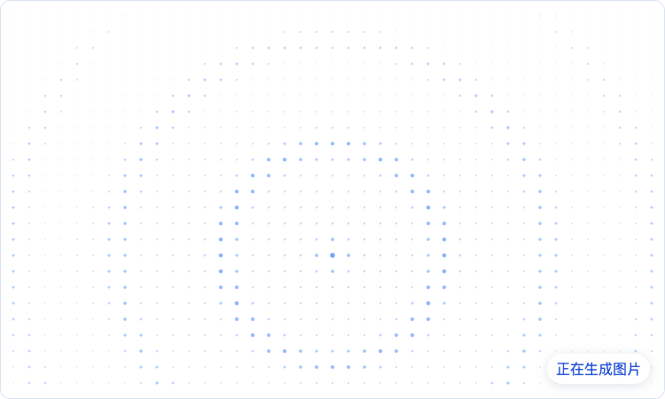
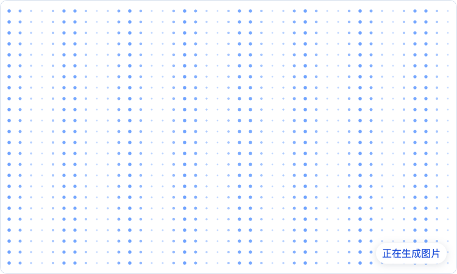
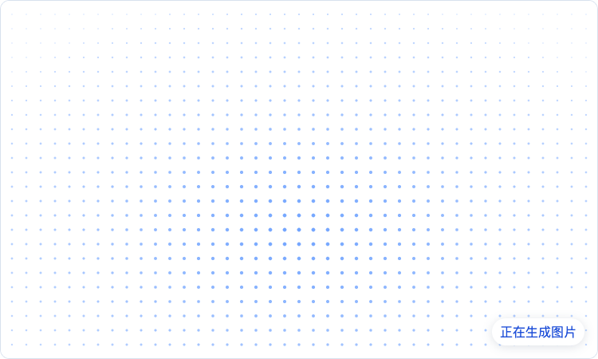

# 点阵波纹式画布加载

产品场景与参考图见[点阵波纹 PRD](dot-matrix-ripple-prd.md)。

Playground 的「点阵与波纹」分组纵向展示 6 种预设，`dot-matrix-wave` 排在首位。每张卡片的参数、暂停状态和演示进度独立保存，展开「参数与演示进度」即可编辑。画布离开视口后停止绘制，重新进入时从原相位继续。原始参考图提供点阵外观，运动方向、周期和波函数由本库定义。

## 视觉与排布

背景默认 `#FFFFFF`，覆盖宿主画布，默认点色 `#4D8DFF`，圆点实心无描边。圆点沿规则网格排列，同一容器尺寸下坐标恒定，半径与透明度随时间变化。整体亮区位于横向中心、纵向 64% 处，沿边缘平滑变淡。动效层裁切到容器，绘图单位为 CSS px。

自动网格使用 `max(1, floor(width / gap))` 列，高度同理。每轴第一点置于 `(dimension - (count - 1) * spacing) / 2`。显式行列使用相应轴的 `dimension / count` 作为步长。ResizeObserver 通知后重排并保持时间轴，零尺寸容器不分配绘制缓冲区。

| 参数 | 默认 | 范围或规则 |
| --- | --- | --- |
| `rows`、`columns` | `auto` | `auto` 或整数 1–160 |
| `gap` | 18 px | 10–40 px。可选 `density=4–24` 映射到 `clamp(28 - .6 * density, 10, 40)`，显式 gap 优先 |
| `origin` | `[.5,.64]` | 容器归一化坐标，各分量 0–1 |
| `direction` | 35° | 顺时针，0° 朝右。方向归一化至 [0,360) |
| `wavelength` | 120 px | 24–480 px |
| `duration` | 1900 ms | 500–8000 ms |
| `amplitude` | 1.4 px | 0–3 px |
| `falloff` | 1.2 | 0–3 |
| `opacity` | 1 | 0–1 |
| `maxDots` | 2500 | 整数 1–2500，超预算时等比例减行列后重新排布 |
| `exitDuration` | 180 ms | 0–300 ms |

## 波形与时钟

令 `dx=x-originX*width`，`dy=y-originY*height`，`t` 为应用速度倍率后的累计毫秒。速度调节只影响后续增量。Canvas 预计算位置、衰减和空间相位，单帧只计算时间相位与可见属性。

```text
distance = hypot(dx / width, dy / height)
weight = max(.12, 1 - distance * falloff)
projected = dx * cos(directionRad) + dy * sin(directionRad)
phase = 2π * (projected / wavelength - (t % duration) / duration)
wave = (sin(phase) + 1) / 2
radius = min(.6 + weight * (.75 + amplitude * wave), .42 * min(stepX, stepY))
alpha = opacity * clamp(.13 + weight * (.18 + .5 * wave), 0, .9)
```

径向版本把投影距离改成 `hypot(dx,dy)`，形成向外传播的环。可用 `crestWidth` 控制每个周期内波峰覆盖比例，在波峰两端平滑过渡。呼吸版本将空间相位限制在较小范围，形成近同步的起伏。漩涡使用角度与径向距离叠加。交互涟漪按触点生成有寿命的径向脉冲，限制同时存在的波源，动画层不能拦截宿主操作。

## Playground 实拍

### 09 点阵波浪

默认从 35° 方向推进，中下部圆点更明显。截图中的 `93%` 来自演示进度控件。



### 10 径向涟漪

移动波源 X、Y 可以改变同心圆的起点。波峰宽度按周期比例设置，空间衰减控制远离波源时的对比度。



### 11 定向波浪

默认以 0° 向右推进，空间衰减为 0。波峰数为「自动」时按波长排布。指定波峰数后，按画布在传播方向上的投影跨度重新分配波峰间距。



### 12 点阵呼吸

截图取自较亮的相位。相位差控制最远边缘相对中心的滞后，设为 0° 时全场同步明暗。



### 13 点阵漩涡

螺旋臂数决定波源周围的波峰分布，扭转控制径向相位变化。截图将间距调为 `12 px`、扭转调为 `0.3`，便于看清三条螺旋臂。


### 14 交互涟漪

点击或轻触画布，从触点发出一圈涟漪。键盘可操作「从中心触发涟漪」按钮。波源达到上限时替换最早的一圈，全部消退后回到静态底图。截图使用 `48 px` 脉冲宽度，从中心触发后截取扩散中的一帧。


## 进度胶囊与退出

进度胶囊以独立 DOM 层置于画布右下角，默认内缩 16 px，内边距 6 × 10 px，白底、全圆角、轻阴影和深蓝字 `#1D4ED8`。宽度至少容纳 `100%`，开启等宽数字。未知进度显示状态文案或由宿主隐藏胶囊，估算进度显示“预计”。胶囊需要适配文本放大和容器缩窄。

内容就绪后冻结最后一帧，淡出点阵和胶囊，同时显示内容。减少动态时立即完成切换，点阵使用固定相位。失败、取消或卸载应停止绘制并清理资源。完成时机由任务状态决定。

## 验收

- 对同一容器比较相邻帧，圆点中心一致，半径与透明度有变化。静止帧的中下部权重高于边缘。
- 在 `t=0` 与 `t=duration` 比较同一输入，半径和透明度相同。调速、暂停、恢复时相位连续。
- 横竖屏、窄容器和 DPR 变化时保留规则排列，点数和缓冲区尺寸符合预算。
- 输入 `null → 93 → 100 → ready`，检查胶囊宽度稳定、真实进度正确、内容就绪后才退出。验证失败与取消。
- 打开减少动态、切到后台、卸载，确认无持续帧回调。性能目标和测量方法见[技术设计](architecture.md)。
