# Loading 动效资源库构想与视觉参考

本文整理对话原稿，保留分类、动效描述、参考图、参数协议、Playground 概念、工程结构与版本规划。开发时以[动效目录](effect-catalog.md)和[技术设计](architecture.md)中的参数及契约为准。

如果准备将 Loading 动画独立成一个开源库，我建议不要只收集传统的 Spinner，而是将其定位为一个 现代化、可配置、跨框架、支持多种视觉风格的 Loading 动效库。

除了常见的旋转、跳动、进度条，还可以涵盖点阵波纹、粒子系统、流体、骨架屏、文字动画、AI 生成动画、3D 空间动画等。

下面整理一份可以直接用于产品规划和后续开发的 Loading 动效资源库清单 v1.0。

## 一、Loading 动效分类体系

建议首批规划 10 个分类、50 种动效。每种动效都拥有独立名称、视觉描述、运动规则、适用场景和可配置参数。

| 编号 | 类别 | 动效数量 |
| --- | --- | --- |
| 01 | 基础几何 | 8 |
| 02 | 点阵波纹 | 6 |
| 03 | 粒子系统 | 6 |
| 04 | 流体液态 | 5 |
| 05 | 文字动效 | 4 |
| 06 | 进度反馈 | 5 |
| 07 | 骨架占位 | 4 |
| 08 | AI 生成 | 5 |
| 09 | 空间 3D | 4 |
| 10 | 品牌创意 | 3 |

## 二、50 种 Loading 动效设计描述

### 01. 基础几何类（Basic Geometry）

适用于按钮、表单、列表、弹窗等常规界面，要求轻量、易识别、低性能开销。

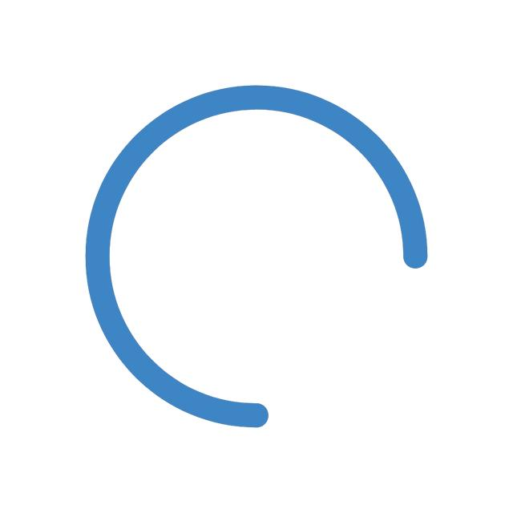

#### 01. Circular Spinner — 环形旋转

一段不完整的圆弧围绕中心连续旋转。圆弧头尾可采用透明度渐变，形成追逐效果。

参数：直径、线宽、颜色、旋转速度、弧长

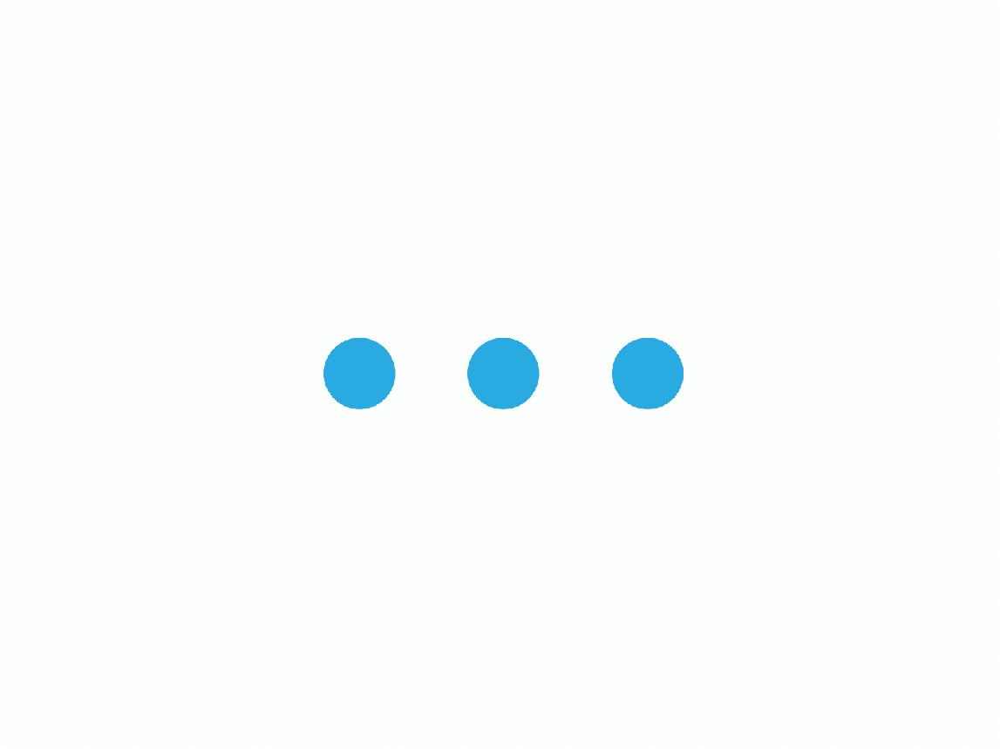

#### 02. Bouncing Dots — 弹跳圆点

三至五个圆点沿水平方向排列，依次上下弹跳，通过时间差形成连续节奏。

参数：数量、间距、弹跳高度、周期、缓动函数

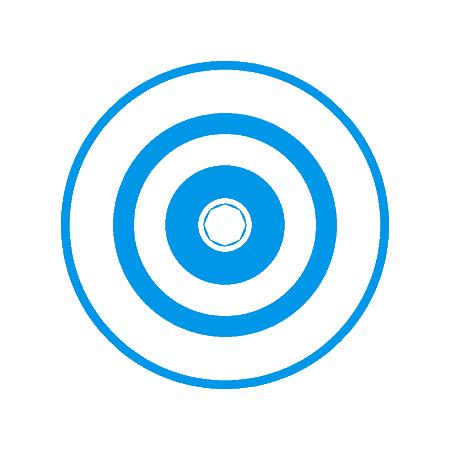

#### 03. Pulse Circle — 呼吸圆环

一个或多个同心圆周期性放大缩小，同时改变透明度，模拟呼吸或心跳。

参数：半径、缩放幅度、透明度、呼吸频率

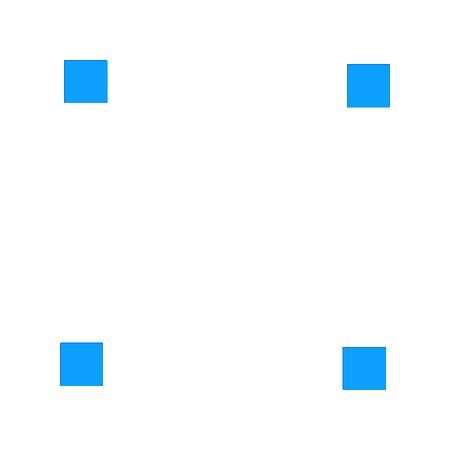

#### 04. Rotating Squares — 方块旋转

一个或多个正方形围绕中心旋转，伴随缩放、错位或交替翻转。

参数：方块数量、边长、旋转角度、方向、速度

其余基础动效：

| 编号 | 动效名称                | 视觉与运动描述               |
| -- | ------------------- | --------------------- |
| 05 | Orbit Dots 轨道圆点     | 多个圆点沿圆形或椭圆轨道运行，形成追逐效果 |
| 06 | Elastic Line 弹性线条   | 水平线段周期性拉伸、收缩和位移       |
| 07 | Morphing Shape 形状变换 | 圆形、方形、菱形之间连续形变        |
| 08 | Flip Tiles 翻转方块     | 多个方块依次沿 X/Y 轴翻转       |

### 02. 点阵与波纹类（Dot Matrix & Ripple）

这一类可以作为项目的特色分类，也是你提供的 ChatGPT 图片生成 Loading 的主要归属。

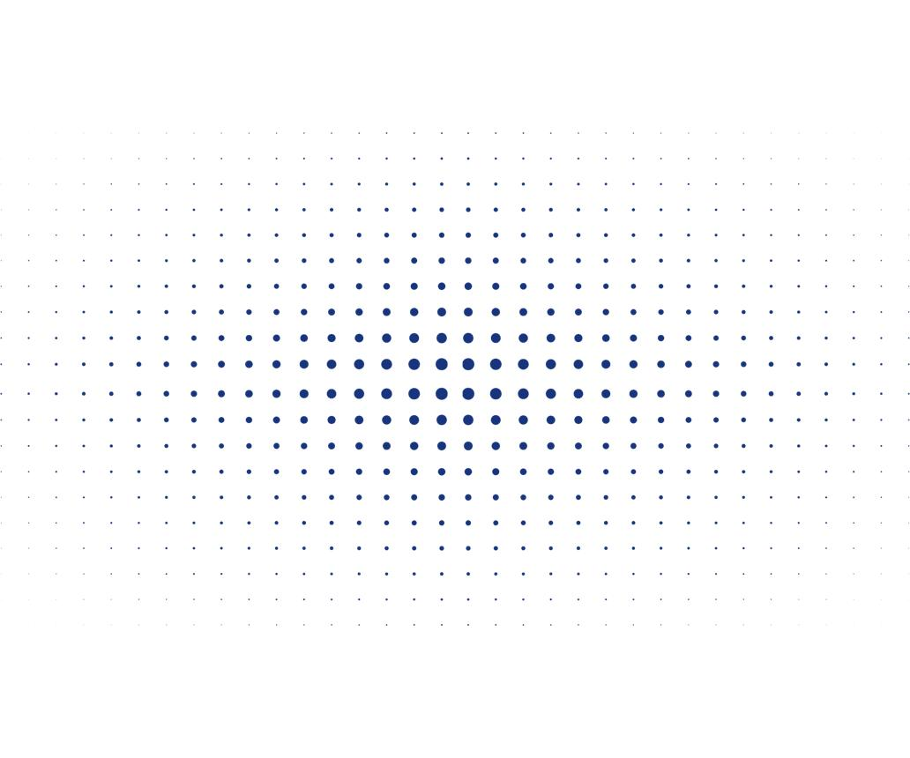

#### 09. Dot Matrix Wave — 点阵波浪

规则二维点阵保持位置固定，圆点尺寸和透明度随波函数变化，形成连续起伏的波浪。

参数：行列数、间距、振幅、频率、传播方向、波长

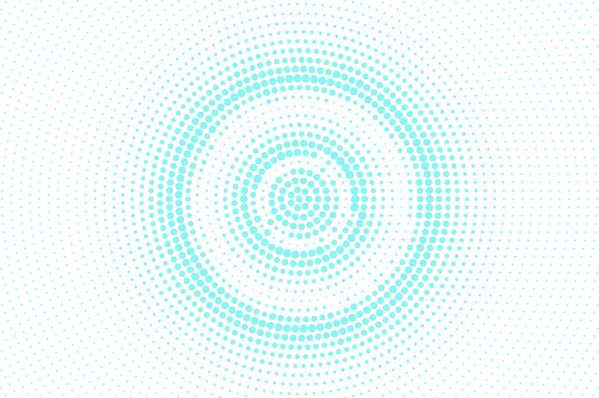

#### 10. Radial Ripple — 径向涟漪

从中心或指定坐标向外传播同心圆波纹。波峰经过时，圆点依次放大并增强颜色。

参数：波源坐标、扩散速度、波峰宽度、衰减系数

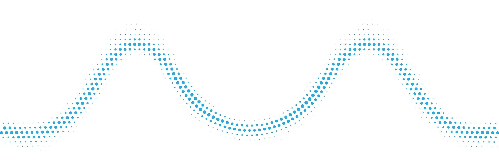

#### 11. Directional Wave — 定向波浪

波纹沿水平、垂直或任意角度穿过点阵，形成扫描般的连续传播。

参数：方向角、速度、波长、波峰数量

| 编号 | 动效名称                    | 视觉与运动描述                |
| -- | ----------------------- | ---------------------- |
| 12 | Matrix Breathing 点阵呼吸   | 所有圆点按照空间权重和相位差周期性缩放    |
| 13 | Matrix Vortex 点阵漩涡      | 以中心为轴形成螺旋相位场，点阵呈现旋涡流动感 |
| 14 | Interactive Ripple 交互涟漪 | 鼠标或触摸位置触发向外扩散的波纹       |

### 03. 粒子系统类（Particle System）

适合 AI 生成、数据处理、文件转换、沉浸式全屏等待等场景。

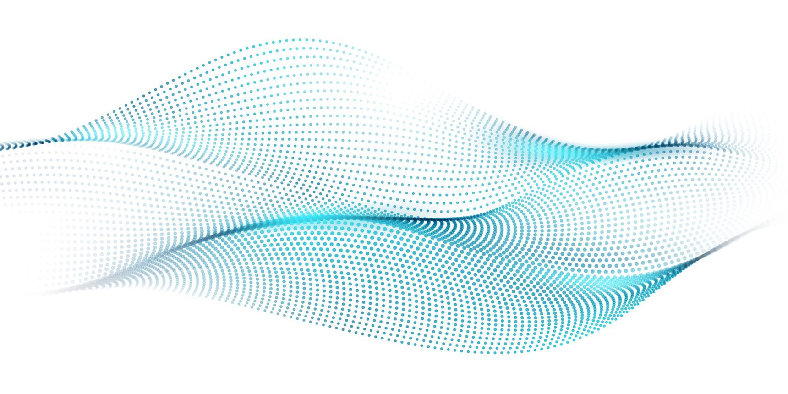

#### 15. Particle Flow — 粒子流

大量微小粒子沿指定方向或曲线路径流动，速度存在轻微差异，形成持续的数据流视觉。

参数：粒子数量、速度、流向、轨迹、寿命

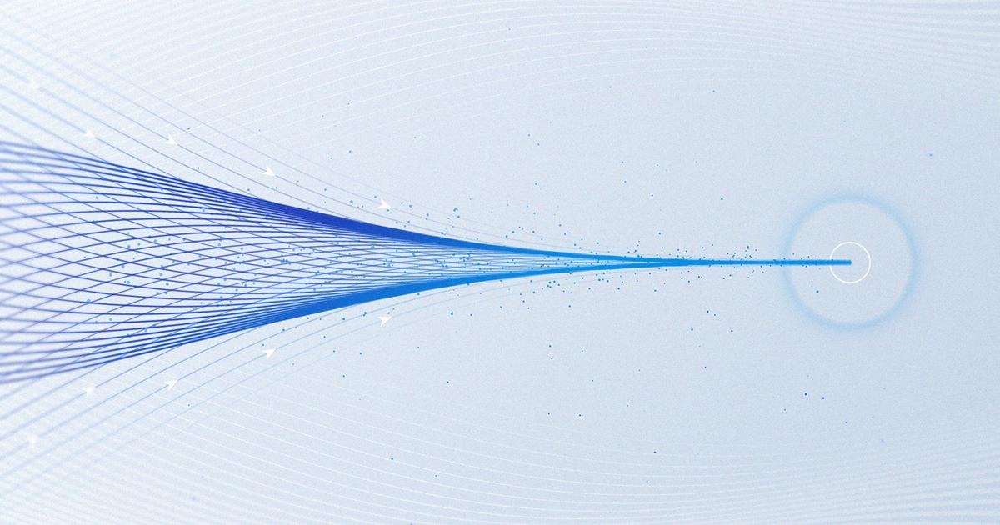

#### 16. Particle Convergence — 粒子汇聚

粒子从画布边缘向中心汇聚，接近中心时逐渐缩小或消失，形成信息收集效果。

参数：汇聚中心、吸引力、粒子密度、衰减

| 编号 | 动效名称                    | 视觉与运动描述             |
| -- | ----------------------- | ------------------- |
| 17 | Particle Explosion 粒子爆发 | 粒子从中心向四周扩散，衰减后重新聚合  |
| 18 | Particle Orbit 粒子轨道     | 粒子沿多层不同半径的轨道旋转      |
| 19 | Particle Morph 粒子变形     | 粒子在不同文字、图案或几何形状之间重组 |
| 20 | Particle Network 粒子网络   | 相邻粒子以细线连接，形成动态网络结构  |

### 04. 流体与液态类（Fluid & Liquid）

强调有机、柔软、连续的视觉效果，适合创意产品和品牌页面。

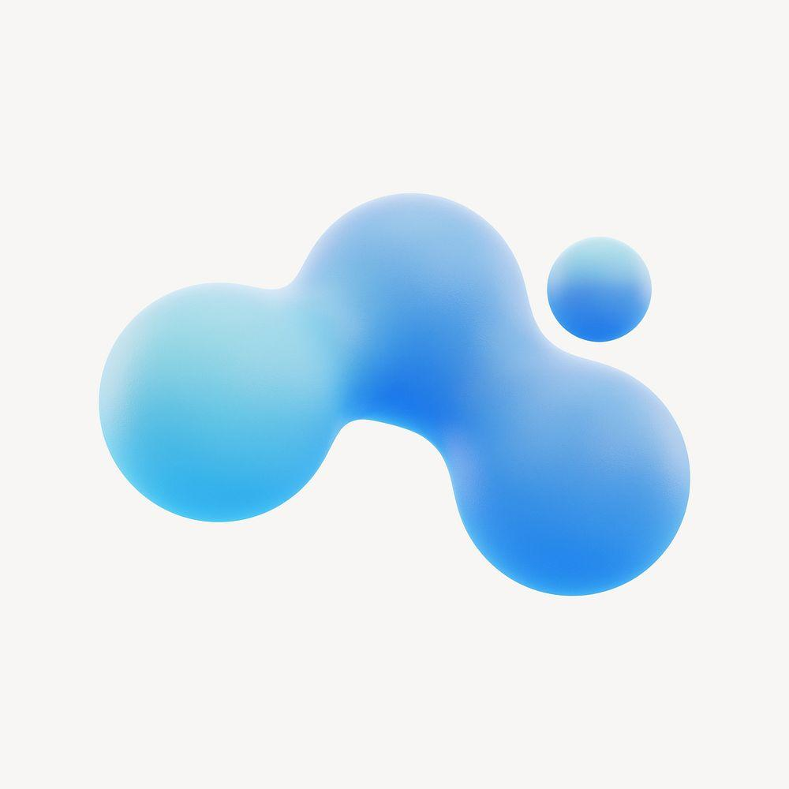

#### 21. Liquid Blob — 液态形变

不规则液态团块连续变形，边界平滑流动。

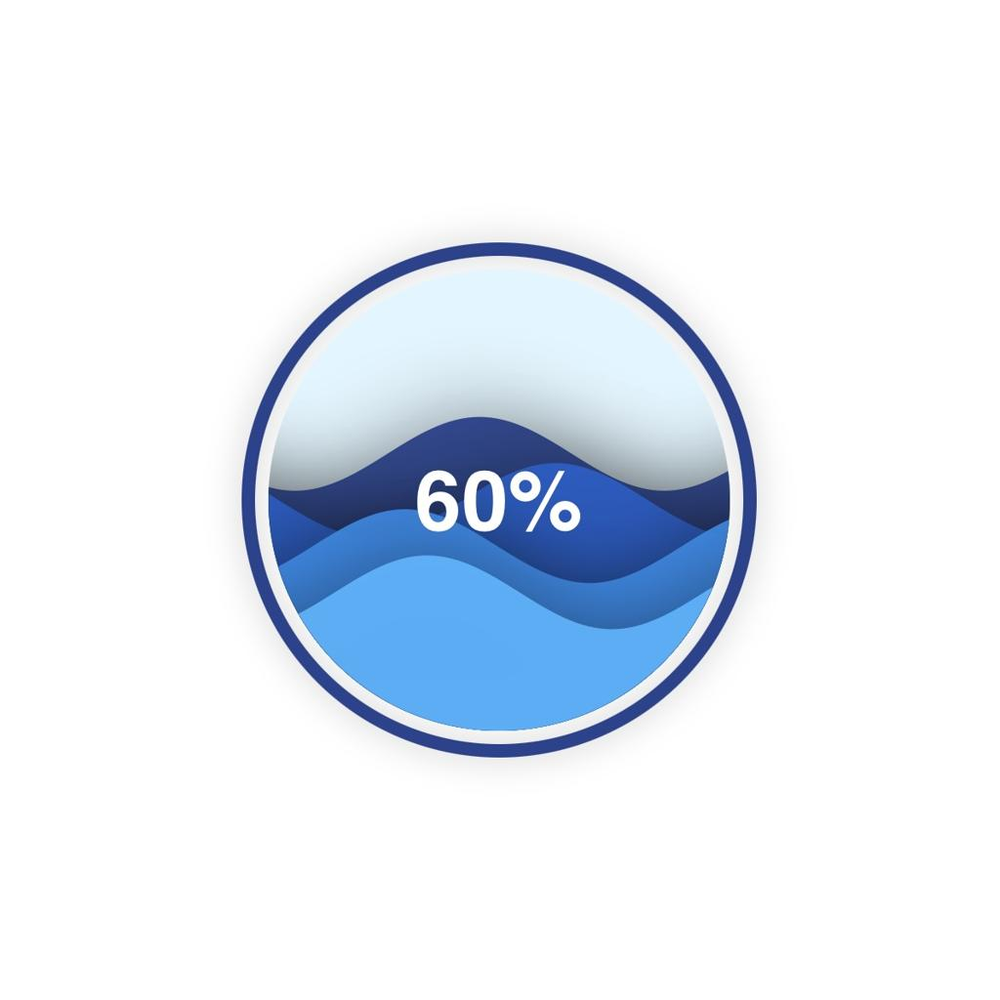

#### 22. Liquid Fill — 液位填充

容器内液体随进度上涨，表面持续波动。

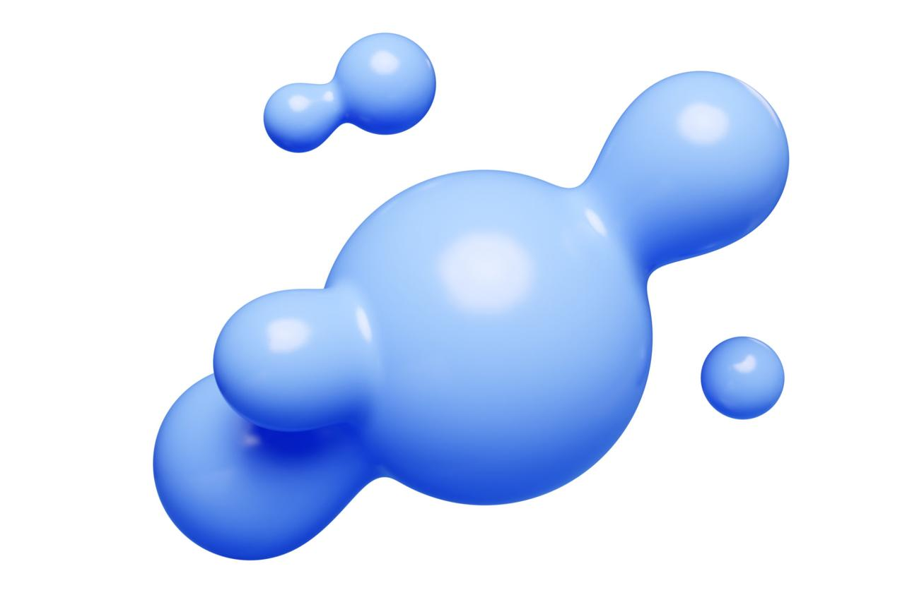

#### 23. Metaball — 融合液滴

多个液滴靠近时融合，分离时产生拉丝效果。

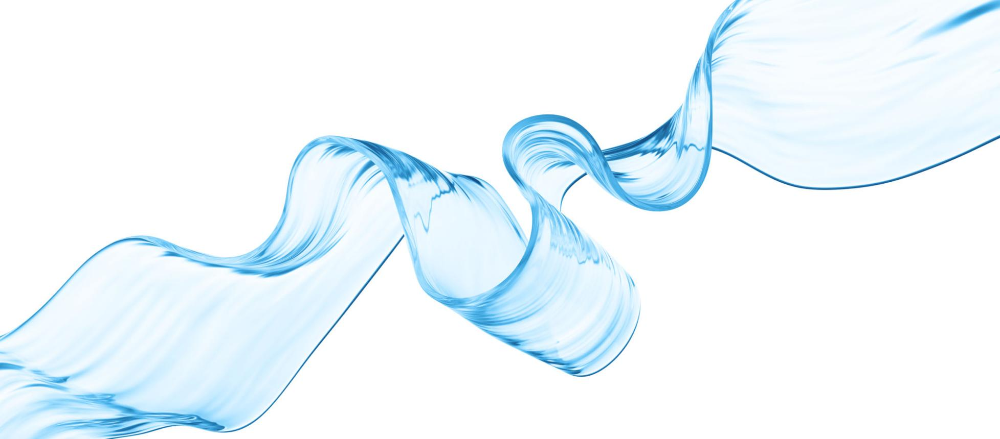

#### 24. Fluid Ribbon — 流体丝带

柔性带状曲面持续扭转、起伏和漂浮。

#### 25. Ink Diffusion — 墨水扩散

颜色从局部向外柔和扩散，形成墨水在液体中蔓延的效果。

### 05. 文字动效类（Typography Loading）

| 编号 | 动效名称                | 视觉与运动描述               |
| -- | ------------------- | --------------------- |
| 26 | Typing Dots 输入省略号   | `Loading` 后的圆点数量周期性变化 |
| 27 | Character Wave 字符波浪 | 字符逐个上下浮动或改变透明度        |
| 28 | Text Shimmer 文字流光   | 高亮渐变从左向右扫过文字          |
| 29 | Scramble Text 字符解码  | 随机字符逐步收敛为目标文字，模拟解码    |

### 06. 进度反馈类（Progress Indicators）

这类需要明确区分真实进度与非确定性等待状态。

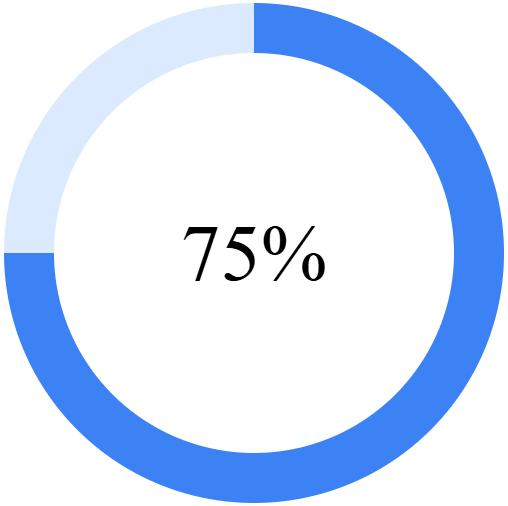

#### 30. Circular Progress — 环形进度

圆环按任务进度逐渐填充，中央显示百分比。

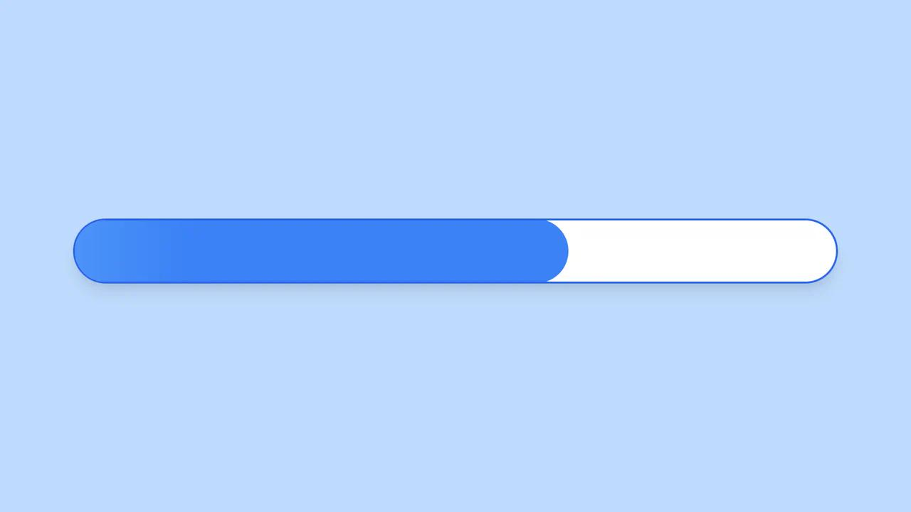

#### 31. Gradient Progress — 渐变进度条

横向进度条逐渐填充，内部可叠加柔和流光。

| 编号 | 动效名称                    | 视觉与运动描述            |
| -- | ----------------------- | ------------------ |
| 32 | Segmented Progress 分段进度 | 由多个独立单元依次填充        |
| 33 | Step Progress 阶段进度      | 按任务阶段依次点亮节点并显示当前状态 |
| 34 | Wave Progress 波浪进度      | 波浪高度随任务进度变化        |

### 07. 骨架屏类（Skeleton Loading）

| 编号 | 动效名称                    | 视觉与运动描述           |
| -- | ----------------------- | ----------------- |
| 35 | Shimmer Skeleton 流光骨架   | 占位区域内有柔和高亮光带循环扫过  |
| 36 | Pulse Skeleton 呼吸骨架     | 占位块透明度周期性变化       |
| 37 | Staggered Skeleton 错峰骨架 | 多个占位块依次渐显或呼吸      |
| 38 | Progressive Reveal 渐进揭示 | 实际内容准备完成后逐块替换占位结构 |

### 08. AI 生成专属类（AI Generation）

这一类可以作为开源库的重点差异化能力。

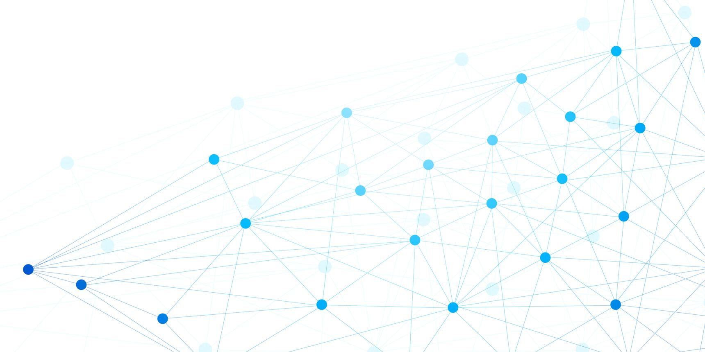

#### 39. Neural Pulse — 神经网络脉冲

节点之间的连接线依次点亮，模拟信息在神经网络中传播。

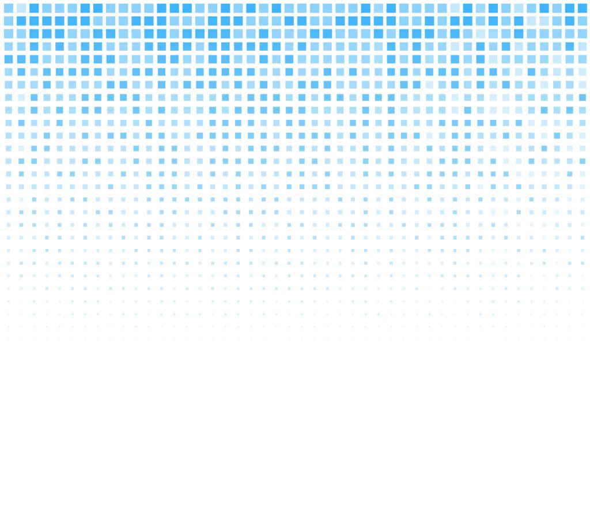

#### 40. Pixel Reconstruction — 像素重构

画布由模糊像素逐步聚合为清晰结构，表现图像生成过程。


#### 41. Diffusion Reveal — 扩散显影

从随机噪声逐步过渡为清晰图像，模拟扩散模型的去噪过程。

| 编号 | 动效名称                 | 视觉与运动描述             |
| -- | -------------------- | ------------------- |
| 42 | Token Stream Token 流 | 小型光点或字符片段沿路径连续出现    |
| 43 | Generative Grid 生成网格 | 网格单元按空间规则依次激活、变化和消退 |

### 09. 空间与 3D 类（Spatial & 3D）

| 编号 | 动效名称                 | 视觉与运动描述            |
| -- | -------------------- | ------------------ |
| 44 | Rotating Cube 旋转立方体  | 立方体围绕多个轴持续旋转       |
| 45 | 3D Dot Sphere 点阵球体   | 球面点阵持续旋转，远近点具有透视差异 |
| 46 | Infinite Tunnel 无限隧道 | 几何图形不断放大并穿过观察视点    |
| 47 | Wireframe Morph 线框变形 | 三维线框在球体、立方体等结构之间变换 |

### 10. 品牌与创意类（Creative Loading）

| 编号 | 动效名称               | 视觉与运动描述                 |
| -- | ------------------ | ----------------------- |
| 48 | Logo Morph 品牌形变    | 品牌 Logo 在抽象几何形状和原始形态间变换 |
| 49 | Infinity Loop 无限循环 | 光点沿 ∞ 形轨道循环移动           |
| 50 | Magnetic Dots 磁吸圆点 | 圆点相互吸引、排斥并形成弹性聚散效果      |

## 三、为开源库设计统一的动效规范

如果每种 Loading 都单独实现，后期会出现参数不统一、渲染器耦合、难以维护等问题。

建议将动效拆成三个层次：

Effect Definition — 动效定义层

名称 / 参数 Schema / 默认值 / 元数据

Animation Engine — 动画引擎层

时间轴 / 缓动 / 波函数 / 粒子 / 插值 / 状态

CSS / DOM

Canvas 2D

WebGL

Renderer — 可替换渲染层

Framework Adapters

Vanilla JS · React · Vue · Web Components

并不是所有动画都需要支持全部渲染器。基础 Spinner 使用 CSS 最合适，点阵波纹适合 Canvas 2D，大规模粒子或 3D 效果则可以采用 WebGL。

## 四、统一参数设计

建议每个动效至少定义以下通用属性。

| 属性              | 类型            | 说明                     |
| --------------- | ------------- | ---------------------- |
| `size`          | number        | 动画尺寸                   |
| `color`         | string        | 主色调                    |
| `background`    | string        | 背景颜色                   |
| `speed`         | number        | 动画速度倍率                 |
| `duration`      | number        | 动画周期，毫秒                |
| `loop`          | boolean       | 是否循环                   |
| `paused`        | boolean       | 是否暂停                   |
| `progress`      | number / null | 0–100 为确定进度，null 为未知进度 |
| `density`       | number        | 点阵或粒子密度                |
| `amplitude`     | number        | 运动振幅                   |
| `opacity`       | number        | 整体透明度                  |
| `renderer`      | string        | 渲染方式                   |
| `reducedMotion` | string        | 减少动态效果的策略              |

各动效还可以定义自己的专属参数。例如点阵波纹增加 `waveLength`、`origin`、`falloff`、`direction` 等。

## 五、开源库的产品形态

建议不仅提供组件，还提供一个可视化动效实验室（Loading Playground），用户可以直接选择动画、调整参数、实时预览并复制代码。

### 点阵动效参数实验

| 原型元素 | 示例 |
| --- | --- |
| 播放控制 | 暂停 |
| 动效类型 | Dot Matrix Wave、Radial Ripple、Matrix Breathing |
| 速度 | 1.0× |
| 点阵密度 | 14 |
| 主题颜色 | 颜色选择 |
| 导出操作 | 复制 React 示例代码 |

原型的 React 组件调用是拟定 API。当前 Playground 纵向展示 6 种点阵与波纹预设，每张卡片支持实时调参、暂停和进度演示。启动步骤见[快速开始](index.md)，各预设的画面见 [点阵与波纹演示](dot-matrix-ripple.md#点阵与波纹演示)。

### 原型源码

以下是对话中的 HTML 与 JavaScript 概念原型。参数由当时的预览容器通过 `globalThis.__bindings` 传入。独立打开时使用默认参数，仓库中的 Playground 提供当前实现和可用的控件。

```html

      <div id="loading-demo" style="width:100%;height:220px;background:#fff;position:relative;overflow:hidden">
        <canvas id="dots-canvas" style="width:100%;height:100%;display:block"></canvas>
      </div>
      <script>
        const root=document.getElementById('loading-demo'),canvas=document.getElementById('dots-canvas'),ctx=canvas.getContext('2d');
        let start=performance.now(),last=0;
        function draw(now){
          const b=globalThis.__bindings||{};
          const cfg={effect:b.effect||'wave',speed:b.speed??1,density:b.density??14,color:b.color||'#4D8DFF',paused:b.paused??false};
          if(!cfg.paused)last=(now-start)*.001*cfg.speed;
          else start=now-last*1000/Math.max(.1,cfg.speed);
          const rect=root.getBoundingClientRect(),dpr=Math.min(devicePixelRatio||1,2);
          if(canvas.width!==Math.round(rect.width*dpr)||canvas.height!==Math.round(rect.height*dpr)){canvas.width=Math.round(rect.width*dpr);canvas.height=Math.round(rect.height*dpr);}
          ctx.setTransform(dpr,0,0,dpr,0,0);ctx.clearRect(0,0,rect.width,rect.height);
          const gap=Math.max(10,28-cfg.density*.6),cols=Math.ceil(rect.width/gap),rows=Math.ceil(rect.height/gap);
          const hex=cfg.color.replace('#',''),r=parseInt(hex.slice(0,2),16),g=parseInt(hex.slice(2,4),16),bl=parseInt(hex.slice(4,6),16);
          for(let y=0;y<=rows;y++)for(let x=0;x<=cols;x++){
            const px=x*gap+gap/2,py=y*gap+gap/2;
            const dx=(px-rect.width*.5)/rect.width,dy=(py-rect.height*.64)/rect.height;
            const dist=Math.hypot(dx,dy),base=Math.max(.12,1-dist*1.2);
            let phase;
            if(cfg.effect==='ripple')phase=dist*28-last*4;
            else if(cfg.effect==='pulse')phase=last*2.5-dist*7;
            else phase=x*.33+y*.27-last*3.3;
            const wave=(Math.sin(phase)+1)/2;
            const radius=.6+base*(.75+wave*1.45);
            ctx.beginPath();ctx.arc(px,py,radius,0,Math.PI*2);
            ctx.fillStyle=`rgba(${r},${g},${bl},${Math.min(.9,.13+base*(.18+wave*.5))})`;ctx.fill();
          }
          requestAnimationFrame(draw);
        }
        requestAnimationFrame(draw);
      </script>
```

## 六、推荐的工程结构

```
loading-effects/
├── packages/
│   ├── core/              # 动画生命周期、时间轴、数学工具
│   ├── effects/           # 50 种动效定义
│   ├── renderer-css/      # CSS 渲染
│   ├── renderer-canvas/   # Canvas 2D 渲染
│   ├── renderer-webgl/    # WebGL 渲染
│   ├── react/             # React 适配
│   ├── vue/               # Vue 适配
│   └── web-components/    # 原生 Web Components
├── apps/
│   ├── docs/              # 文档网站
│   └── playground/        # 动效实验室
├── examples/
│   ├── vanilla/
│   ├── react/
│   └── vue/
└── tests/
```

对于开源项目，建议从第一版就考虑按需导入、Tree Shaking、SSR 安全、资源释放、容器自适应、无障碍支持、TypeScript 类型声明，以及不同浏览器的兼容性。

## 七、建议的开发优先级

不建议第一版就实现全部 50 种。可以分为三个阶段：

| 版本   | 范围                       | 交付目标                            |
| ---- | ------------------------ | ------------------------------- |
| v0.1 | 基础几何 8 种 + 点阵 6 种        | 动效引擎、Canvas/CSS 渲染、React/Vue 接入 |
| v0.2 | 粒子 6 种 + 进度 5 种 + 骨架 4 种 | 完善性能、进度反馈、可访问性                  |
| v1.0 | 剩余 21 种                  | WebGL、复杂视觉效果、完整文档与 Playground   |

其中我建议将 Dot Matrix Wave（点阵波浪） 作为首个标志性动效，因为它既能实现你最初展示的视觉效果，也可以通过不同的波函数衍生出径向波纹、漩涡、呼吸、扫描等多个变体。

这个库真正值得做的差异化，不只是提供 50 个 Loading 组件，而是让开发者能够通过统一参数、可组合动画算法和可替换渲染器，创造出更多 Loading 效果，同时保持易用性与高性能。
